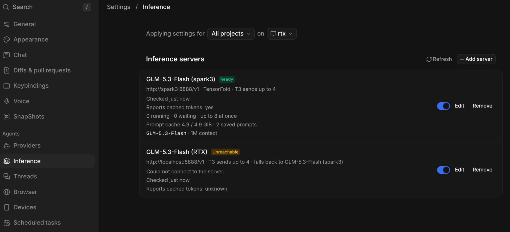
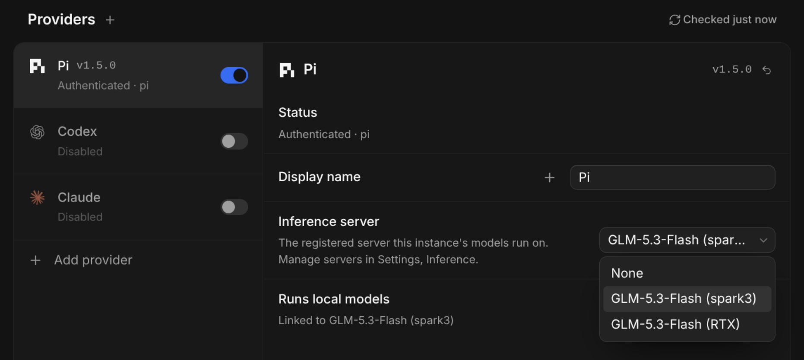
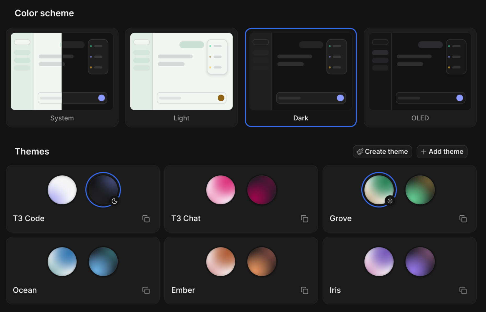

# T3 Code (local-first fork)

This is a fork of [T3 Code](https://github.com/pingdotgg/t3code). For everything T3 Code does,
see the upstream README. This page covers only what this fork adds.

## What's different

Local models come first. Cloud providers keep working, but models on your own hardware are the
default and the core of the app.

### Local first

- **Runs local models**: mark a provider instance as local. Local instances come first in the
  model picker and provider lists, and new threads default to them.
- **Background writing stays local**: thread titles, commit messages, PR text, branch names and
  voice cleanup use a local model. **Background writing fallback** defaults to **Local models only**,
  so your diffs never move to a cloud provider on their own, even before any local model is set up.
- **Local is never priced**: local models show **Local** instead of a cloud price and never add to
  the cost total.

### Inference servers

- **Settings → Models & agents → Model servers**: register your model servers (Ollama, LM Studio, llama.cpp, vLLM,
  SGLang, TensorFold, or anything OpenAI-compatible). Each shows its readiness, models, context
  windows, load, last failure and, on TensorFold, prompt cache health.
- **Fallback server**: a server can name another to take its requests when it is down. It is not
  for overflow, and a request that already started is never moved.
- **Link a provider to a server**: Pi, OpenCode and Codex (experimental) get a managed
  `t3-<server>` provider with every model the server reports, sized from what it serves. No
  `models.json` or `opencode.json` editing.





### The inference gateway

Linked providers send their requests through T3 Code, which:

- queues requests per server (**Max concurrent requests**) so parallel threads take turns instead
  of overloading the GPU. Chat goes ahead of background writing, and a waiting thread shows
  `Waiting for <server> · N ahead`.
- keeps each running session on the server and settings it started with, and keeps a Responses
  conversation on the server that produced it.
- records each request's prompt, cached, and output tokens, queue wait, time to first token and
  decode speed, never the prompt or response text.
- cancels the upstream request when a thread stops or T3 Code restarts.

### Seeing what your hardware did

- **Usage → Local compute**: requests, failures, tokens, cache share, and median and p95 queue
  wait, time to first token and decode speed, per server, model and purpose.
- **Last request** in a thread's details: prompt size, cached share, time to first token, which
  server answered, and whether the instructions or tools changed since the previous request.
- The mobile app shows the same server and compute views, read-only.

### Agents tuned for local models

- **Lean T3 tools** for Pi on a linked server: a smaller tool set and shorter instructions, about
  40% fewer prompt tokens with the same eval results on GLM.
- **Cache-friendly compaction**: Pi compacts long threads from the server's prompt cache instead
  of re-reading the whole thread.
- **Codex on a local server**: T3's tool groups are flattened for servers that accept only plain
  function tools.
- **Local harness evals**: `evals/mcp-tool-use` runs a local model through Pi, Codex and OpenCode
  side by side (`--harness`), recording tool-call validity, tokens and time to first token.

### Appearance

- **Dark** is two-tone: gray sidebar and panels over a near-black main area. The original
  true-black dark is kept as **OLED**. Pick either in **Settings → Appearance** or the command
  palette.



## Build it

Linux desktop app (needs Node 26, pnpm, a recent Rust, `libsecret-1-dev` and ImageMagick):

```sh
vp i
vp run dist:desktop:linux
```

The AppImage is written to `release/`. It does not auto-update; rebuild to update.

See [Local models](./docs/user/local-models.md) for setting up servers and providers.

## Credits and license

T3 Code is built by [T3 Tools](https://github.com/pingdotgg/t3code) and its contributors. This
fork builds on their work and keeps their copyright notice. It is an independent fork, not
affiliated with or endorsed by T3 Tools.

Released under the [MIT License](./LICENSE), the same as upstream. Third-party notices are in
[third-party-licenses](./third-party-licenses).
