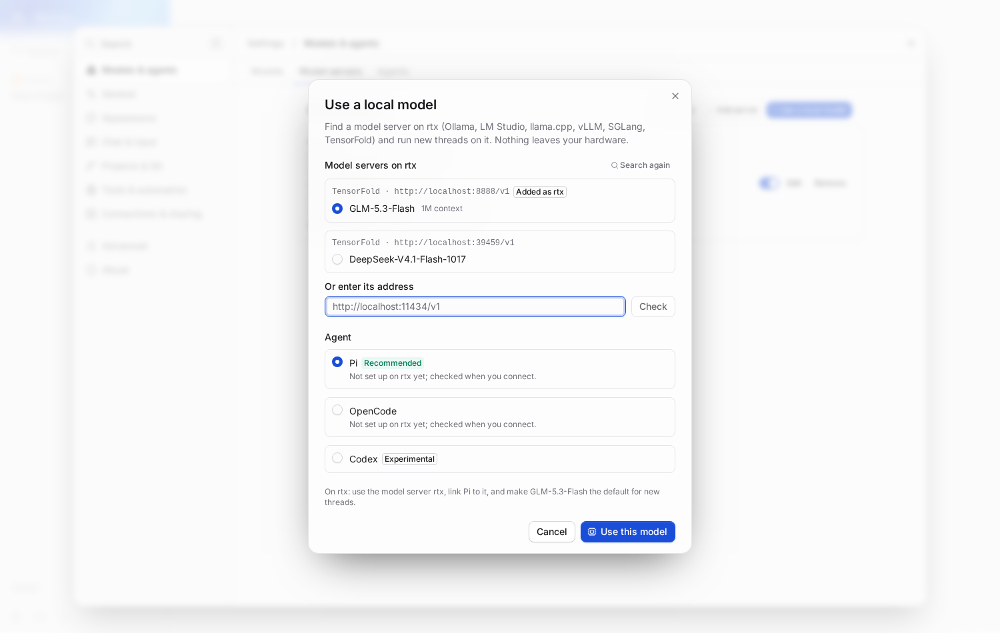
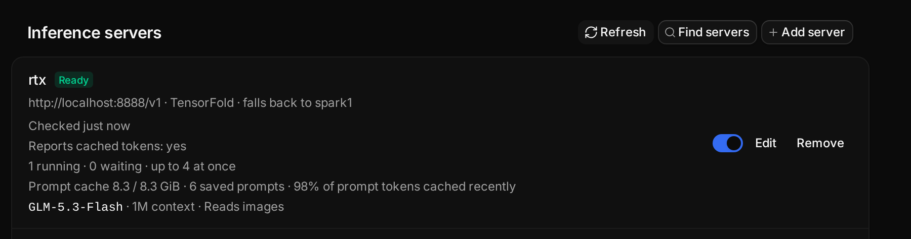
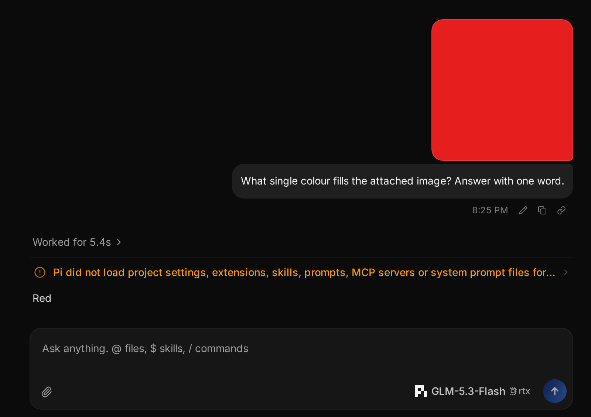

# T3 Code (local-first fork)

This is a fork of [T3 Code](https://github.com/pingdotgg/t3code). For everything T3 Code does,
see the upstream README. This page covers only what this fork adds; [MIA_CHANGELOG.md](./MIA_CHANGELOG.md)
lists every change in order.

## What's different

Local models come first. Cloud providers keep working, but models on your own hardware are the
default and the core of the app.

### Local first

- **Use a local model**: one step from first run, Settings, the model picker, or the command
  palette. T3 Code finds the model servers on your machine (Ollama, LM Studio, llama.cpp, vLLM,
  SGLang, TensorFold), links an agent to the one you pick, and makes its model the default for new
  threads. Running it again reuses what it set up.
- **Repair instead of "Unreachable"**: when a server stops answering, **Find server** looks on its
  machine for where it moved and moves it there, keeping its name, key and linked agents. A thread
  whose agent depends on it says so above the message box.
- **Never quietly cloud**: **Local models only** holds even before any local model is set up, and a
  Codex instance linked to a server waits for it instead of falling back to your OpenAI login.
- **Runs local models**: mark a provider instance as local. Local instances come first in the
  model picker and provider lists, and new threads default to them.
- **Background writing stays local**: thread titles, commit messages, PR text, branch names and
  voice cleanup use a local model. **Settings → Threads → Text generation fallback** defaults to
  **Local models only**, so your diffs never move to a cloud provider on their own.
- **Local is never priced**: local models show **Local** instead of a cloud price and never add to
  the cost total.
- **The picker says where a model runs**: a local model in the model picker and message box shows
  the machine and server it runs on.
- **No longer served**: when a server stops listing the model a thread is set to, the message box
  says so and offers the models it serves now, instead of failing on send.



### Inference servers

- **Settings → Inference**: register your model servers (Ollama, LM Studio, llama.cpp, vLLM,
  SGLang, TensorFold, or anything OpenAI-compatible). Each shows its readiness, models, context
  windows, load, last failure and, on TensorFold, prompt cache health.
- **Fallback server**: a server can name another to take its requests when it is down. It is not
  for overflow, and a request that already started is never moved.
- **Link a provider to a server**: Pi, OpenCode and Codex (experimental) get a managed
  `t3-<server>` provider with every model the server reports, sized from what it serves. No
  `models.json` or `opencode.json` editing.


### The inference gateway

Linked providers send their requests through T3 Code, which:

- queues requests per server (**Max concurrent requests**) so parallel threads take turns instead
  of overloading the GPU. Chat goes ahead of background writing, and a waiting thread shows
  `Waiting for <server> · N ahead`.
- keeps each running session on the server and settings it started with, and keeps a Responses
  conversation on the server that produced it.
- records each request's prompt, cached, and output tokens, queue wait, time to first token and
  decode speed, never the prompt or response text.
- cancels the upstream request when a thread stops or T3 Code restarts.
- stops a runaway reply so it no longer holds the GPU: one that keeps repeating the same text,
  reasons for about 128 KB without answering, or sends nothing for 5 minutes before its first
  token (2 minutes after). The thread says why, with **Continue** and **Choose model**. Turn it
  off per server with `"watchdog": { "enabled": false }`.

### Images for local models

- **Check images**: on **Settings → Inference**, T3 Code asks a model to name the colour of four
  test images and marks it **Reads images** or **Text only**. Ollama, LM Studio and llama.cpp
  report vision themselves, so their models are marked without a check.
- **Images reach the model**: Pi and OpenCode send your image attachments to a linked model unless
  it is known to read text only. Attaching an image to a model nobody has checked starts the check
  on its own, and the message box says when a model will not see the image.





### Seeing what your hardware did

- **Usage → Local compute**: requests, failures, tokens, cache share, and median and p95 queue
  wait, time to first token and decode speed, per server, model and purpose.
- **Last request** in a thread's details: prompt size, cached share, time to first token, which
  server answered, and whether the instructions or tools changed since the previous request.
- The mobile app shows the same server and compute views, read-only.

### Agents tuned for local models

- **Lean T3 tools** for Pi on a linked server: a smaller tool set and shorter instructions, about
  40% fewer prompt tokens with the same eval results on GLM.
- **Cache-friendly compaction**: Pi compacts long threads from the server's prompt cache instead
  of re-reading the whole thread.
- **Codex on a local server**: T3's tool groups are flattened for servers that accept only plain
  function tools.
- **Local harness evals**: `evals/mcp-tool-use` runs a local model through Pi, Codex and OpenCode
  side by side (`--harness`), recording tool-call validity, tokens and time to first token.

### Projects on any machine

- **Add project**: pick a machine, then click through its folders. Hosts in your `~/.ssh/config`
  are listed too; picking one connects it. Open it with the **New project** button next to
  **New thread** in the sidebar, or from **Ctrl+K**.
- **SSH machines run this fork**: the desktop app carries its own server for x64 and arm64 (such
  as a DGX Spark) and installs it on machines you add over SSH, so inference servers, the gateway
  and image checks work there too. Nothing is downloaded from upstream.
- **One model server, every machine**: Settings → Inference on a machine lists the servers on
  your other machines with **Add here**, with `localhost` already changed to the machine that runs
  them.

### A calmer sidebar

- **Thread cards read title first**: the title with its status and time, then one quiet line with
  a short project name, the branch only when it is not the default, the pull request and the diff.
  Provider icons appear only when your threads use more than one.
- **Settled stays out of the way**: it collapses to one line, opens to the five most recent
  threads, and shows **Un-settle** when you hover a row.

### Works with the T3 Code mobile app

- The official T3 Code app for iPhone connects to this fork's server and keeps working: the fork
  only adds to the protocol, it never renames or removes anything.
- Settings and thread states keep T3 Code's own pages and names (**Settled**, **Environments**,
  **Inference**), so the desktop and the phone read the same.

### Appearance

- **Dark** is two-tone: gray sidebar and panels over a near-black main area. The original
  true-black dark is kept as **OLED**. Pick either in **Settings → Appearance** or the command
  palette.


## Build it

Linux desktop app (needs Node 26, pnpm, a recent Rust, `libsecret-1-dev` and ImageMagick):

```sh
vp i
scripts/mia-build-remote-runtime.sh spark5   # optional: server archives for SSH machines
vp run dist:desktop:linux
```

`mia-build-remote-runtime.sh` builds the server for x64 here and for arm64 on the host you name
(which needs Node 26 and Rust in its home directory and a checkout at `~/src/t3code-mia`), both from
the committed `HEAD`. Without it, the app falls back to upstream's server on SSH machines.

The AppImage is written to `release/`. It does not auto-update; rebuild to update.

See [Local models](./docs/user/local-models.md) for setting up servers and providers.

## Credits and license

T3 Code is built by [T3 Tools](https://github.com/pingdotgg/t3code) and its contributors. This
fork builds on their work and keeps their copyright notice. It is an independent fork, not
affiliated with or endorsed by T3 Tools.

Released under the [MIT License](./LICENSE), the same as upstream. Third-party notices are in
[third-party-licenses](./third-party-licenses).
